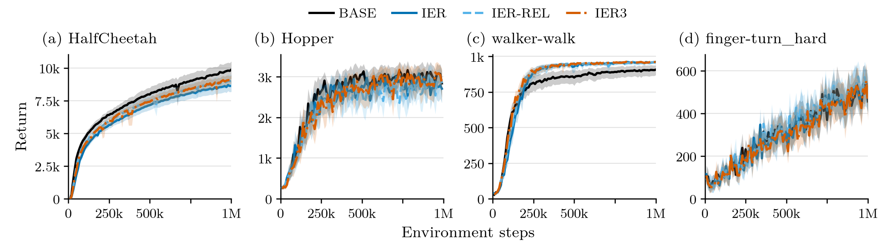
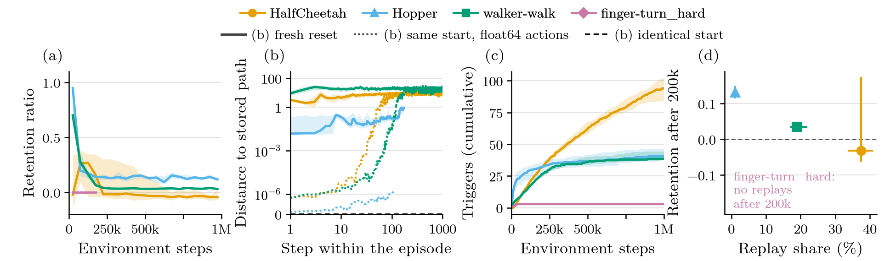
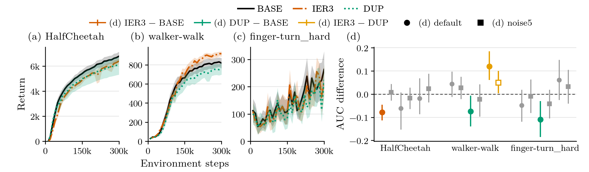
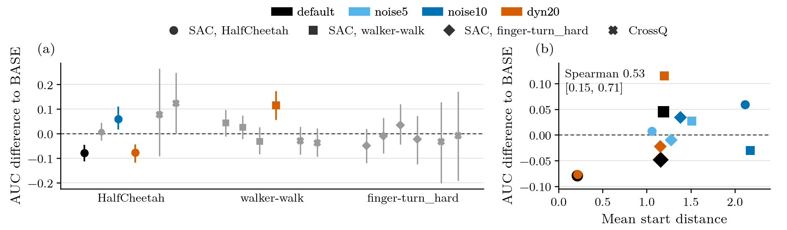

# When Does Instant Episode Repetition Help? A Reproducibility Study with Replay Diagnostics

Code and reproduction instructions for an anonymous submission.

## Abstract

Instant Episode Repetition (IER) re-executes the action sequence of the best training episode so far, open-loop, for a fixed number of later episodes. Its original evaluation reports faster learning for off-policy learners with five seeds. We reproduce its claims for soft actor-critic (SAC) on four of the original tasks with 20 seeds per arm and an analysis plan fixed and hashed before the main runs. We add the released-code schedule, a fixed repeat count, a control that copies the stored episode into the replay buffer, perturbed start states and dynamics, and CrossQ as a stronger base learner. The effect of IER depends on the task. Its difference in normalized area under the learning curve (AUC) against SAC alone is -0.090 [-0.134, -0.050] on HalfCheetah and 0.050 [0.007, 0.096] on walker-walk, a small gain that does not survive an exploratory multiple-comparison correction. Hopper and finger-turn_hard show no clear difference, and we detect no clear AUC improvement for CrossQ. After the first 200k steps, on the three tasks that still trigger replays, an open-loop replay keeps a median of under 15% of the stored return. Yet on walker-walk re-execution beats copying the episode into the buffer, and in an exploratory test it also beats replaying random past episodes, whose replays keep far more of their return. Under perturbed starts and dynamics we detect no clear reduction in the advantage of IER, and in some conditions it grows while both arms lose absolute performance. Reproducing a high return and producing useful training data are therefore different questions, and we recommend testing IER per task against the base learner.

## Main results

Differences are in normalized AUC (area under the evaluation curve, divided by the final return of SAC alone), paired over 20 seeds, with 95% bootstrap intervals. Verdicts follow rules fixed and hashed before the main runs, applied by [`iers/verdicts.py`](iers/verdicts.py). The walker-walk gain does not survive the exploratory multiple-comparison correction of the paper.

| Question | Answer | Evidence |
|---|---|---|
| Does IER improve SAC? | Depends on the task | P(IER > BASE) 0.43 [0.34, 0.52]. walker-walk +0.050 [0.007, 0.096], HalfCheetah -0.090 [-0.134, -0.050] |
| Does the replay schedule matter? | On one task | HalfCheetah, paper schedule minus released code -0.032 [-0.059, -0.007] |
| Re-executing or copying the episode? | Re-executing is better on walker-walk | IER3 minus DUP on walker-walk +0.119 [0.060, 0.184], never clearly worse |
| Do replays keep the stored return? | Far from it | Median retention below 1 in 34 of 34 cells |
| Does the gain shrink under stress? | No clear reduction | On HalfCheetah the IER3 gain rises from -0.079 under default starts to +0.007 under noise5 and +0.059 under noise10. Rank correlation of the gain with start distance +0.53 [0.15, 0.71] |
| Does it help a stronger learner? | No clear gain | No clear CrossQ gain on any task, and a clear loss on walker-walk, -0.099 [-0.155, -0.037]. CrossQ alone beats SAC by 0.175 to 0.310 on three tasks |
| Is the per-task repeat count needed? | No clear loss without it | RN = 3 is never clearly worse than the per-task RN |
| Does early replay retention go with the gain? | No clear link | Rank correlation 0.03 [-0.27, 0.30] across 34 cells |
| Does the gain need the best episode? (exploratory) | Yes, on walker-walk | Random past episode minus best -0.058 [-0.114, -0.002], minus copying +0.062 [0.007, 0.116] |
| Is replay exact? (exploratory) | From the same start, yes | 185 of 190 stored episodes replay bit for bit, the rest within 2e-6. From new starts, episodes stored after 100k steps keep a median 33% (HalfCheetah), 30% (Hopper), 7% (walker-walk) of their return. A rounding-level change to the actions moves the return by a median 67% (HalfCheetah) and 33% (walker-walk) |


*SAC alone (BASE), with IER under the published and the released schedule, and with a fixed repeat count of 3 (IER3). Mean evaluation return over 20 seeds with 95% bootstrap bands, 1M steps.*


*What a replay keeps: retention of the stored return over training, drift of a replay away from its stored episode, how long replays keep happening, and the share of steps they take.*


*Re-executing the best episode (IER3) against inserting copies of it into the buffer (DUP) and SAC alone (BASE), 300k steps.*


*IER3 gain over BASE under default starts, 5x and 10x reset noise, and per-episode dynamics changes (dyn20), for SAC and CrossQ.*

The figures of the paper (PDF and PNG) are in [`paper_assets/figures/main/`](paper_assets/figures/main) and its tables in [`paper_assets/tables/main/`](paper_assets/tables/main). [`paper_assets/README.md`](paper_assets/README.md) lists every folder.

## Reproducing

See **[reproduce/README.md](reproduce/README.md)** for setup, the GPU hours behind each result, and how to retrain and check any of them on your own GPU. Every figure and table of the paper can be rebuilt from the shipped records without training. In short:

```bash
conda env create -f environment.yml && conda activate ierstress
python scripts/run_main.py --item A1 --tasks walker-walk    # train the runs behind one result
python scripts/aggregate.py                                 # contrasts and intervals in results/aggregated/
python scripts/make_paper_assets.py                         # figures and tables of the paper from results/
```

## Repository

| Path | Content |
|---|---|
| [`iers/`](iers) | Training code: SAC and CrossQ trained as stacked groups of seeds, the IER, released-schedule and copy arms, test conditions, analysis and plots. The paper figures and tables are in [`iers/plotting/paper/`](iers/plotting/paper) |
| [`scripts/`](scripts) | Entry points for training, aggregation, the replay and precision checks, and the figures and tables |
| [`configs/`](configs) | Task settings, reset spreads and the frozen analysis configuration |
| [`results/`](results) | Records of every run (without the per-episode files), the aggregated results, and the stored episodes of the replay and precision checks |
| [`paper_assets/`](paper_assets) | Figures and tables of the paper |
| [`reproduce/`](reproduce) | Reproduction guide |
| [`third_party/ier/`](third_party/ier) | The original IER code (MIT), unmodified |

## Reference

IER: Yamani et al., *Instant Episode Repetition*, Reinforcement Learning Journal, 2026 (arXiv 2608.17347). Code: https://github.com/UoA-CARES/instant-episode-repetition.
