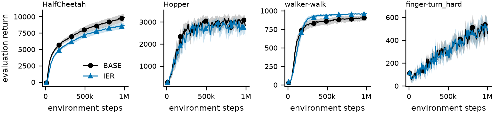
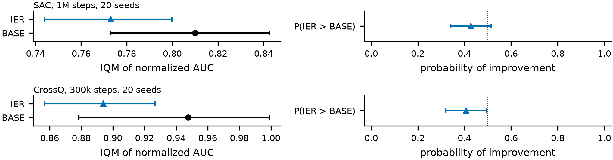
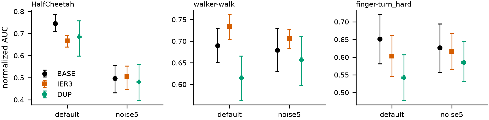
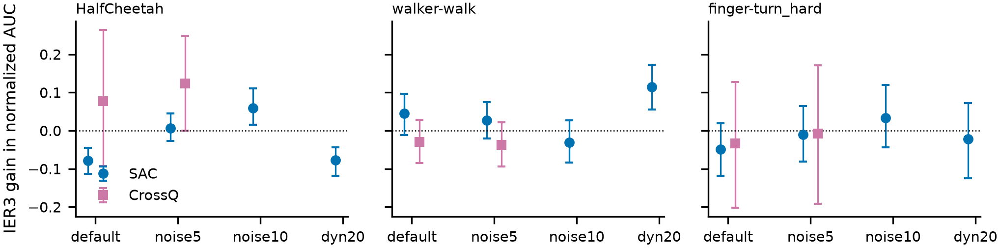

# Does Repetition Really Reinforce? A Stress Test of Instant Episode Repetition

Code and reproduction instructions for an anonymous submission.

## Abstract

Instant Episode Repetition (IER) replays the action sequence of each new best episode, open-loop, for the next few episodes, and reports faster learning for SAC. We test whether this gain holds, why it holds, and where it stops. With 20 seeds per cell, rliable statistics and an analysis plan fixed and hashed before the main runs, we train 1,280 agents on two Gymnasium and two DeepMind Control tasks. IER does not improve SAC overall. The probability that it beats SAC alone is 0.43 [0.34, 0.52], with a clear gain on walker-walk and a clear loss on HalfCheetah. Where it helps, re-executing the actions does better than copying the same episode into the replay buffer, and a control that re-executes a random past episode shows that the gain needs the best one. A stored episode replays exactly from its own start state but keeps only a fraction of its return from a new one. Against our expectation, noisier starts do not shrink the effect. IER gives no clear gain to the stronger learner CrossQ, and a fixed repeat count does as well as the per-task values.

## Main results

Differences are in normalized AUC (area under the evaluation curve, divided by the final return of SAC alone), paired over 20 seeds, with 95% bootstrap intervals. Verdicts follow fixed rules, applied by [`iers/verdicts.py`](iers/verdicts.py).

| Question | Answer | Evidence |
|---|---|---|
| Does IER improve SAC? | Not overall | P(IER > BASE) 0.43 [0.34, 0.52]. walker-walk +0.050 [0.007, 0.096], HalfCheetah -0.090 [-0.134, -0.050] |
| Does the replay schedule matter? | On one task | HalfCheetah, paper schedule minus released code -0.032 [-0.059, -0.007] |
| Re-executing or copying the episode? | Re-executing does better | IER3 minus DUP on walker-walk +0.119 [0.060, 0.184], never clearly worse |
| Do replays keep the stored return? | No | Below the stored return in 34 of 34 cells |
| Does the gain shrink under stress? | No | HalfCheetah: larger under noise5 (+0.086) and noise10 (+0.138). Spearman with start distance +0.53 [0.15, 0.71] |
| Does it help a stronger learner? | No | No clear CrossQ gain, walker-walk -0.099 [-0.155, -0.037]. CrossQ alone beats SAC by 0.18 to 0.31 on three tasks |
| Is the per-task repeat count needed? | No | RN = 3 is never clearly worse than the per-task RN |
| Does early replay retention go with the gain? | No | Spearman 0.03 [-0.27, 0.30] across 34 cells |
| Does the gain need the best episode? (exploratory) | Yes, on walker-walk | Random past episode minus best -0.058 [-0.114, -0.002], minus copying +0.062 [0.007, 0.116] |
| Is replay exact? (exploratory) | From the same start, yes | 185 of 190 stored episodes replay bit for bit, the rest within 2e-6. From new starts, episodes stored after 100k steps keep a median 33% (HalfCheetah), 30% (Hopper), 7% (walker-walk) of their return |


*SAC with (IER) and without (BASE) episode repetition, 1M steps, mean evaluation return over 20 seeds with 95% intervals.*


*Across the four tasks: interquartile mean of normalized AUC and probability that IER improves on BASE, for SAC (1M steps) and CrossQ (300k).*


*Re-executing the best episode (IER3) against inserting copies of it into the buffer (DUP) and SAC alone (BASE), 300k steps.*


*IER3 gain over BASE under default starts, 5x and 10x reset noise, and per-episode dynamics changes (dyn20), for SAC and CrossQ.*

All figures (PDF and PNG) are in [`paper_assets/figures/`](paper_assets/figures) and the LaTeX tables in [`paper_assets/tables/`](paper_assets/tables).

## Reproducing

See **[reproduce/README.md](reproduce/README.md)** for setup, the GPU hours behind each result, and how to retrain and check any of them on your own GPU. In short:

```bash
conda env create -f environment.yml && conda activate ierstress
python scripts/run_main.py --item A1 --tasks walker-walk    # train the runs behind one result
python scripts/aggregate.py                                 # contrasts and intervals in results/aggregated/
```

## Repository

| Path | Content |
|---|---|
| [`iers/`](iers) | Training code: SAC and CrossQ trained as stacked groups of seeds, the IER, released-schedule and copy arms, test conditions, analysis and plots |
| [`scripts/`](scripts) | Entry points for training, aggregation, figures, tables and the replay check |
| [`configs/`](configs) | Task settings, reset spreads and the frozen analysis configuration |
| [`paper_assets/`](paper_assets) | Figures and tables of the paper |
| [`reproduce/`](reproduce) | Reproduction guide |
| [`third_party/ier/`](third_party/ier) | The original IER code (MIT), unmodified |

## Reference

IER: Yamani et al., *Instant Episode Repetition*, Reinforcement Learning Journal, 2026 (arXiv 2608.17347). Code: https://github.com/UoA-CARES/instant-episode-repetition.
